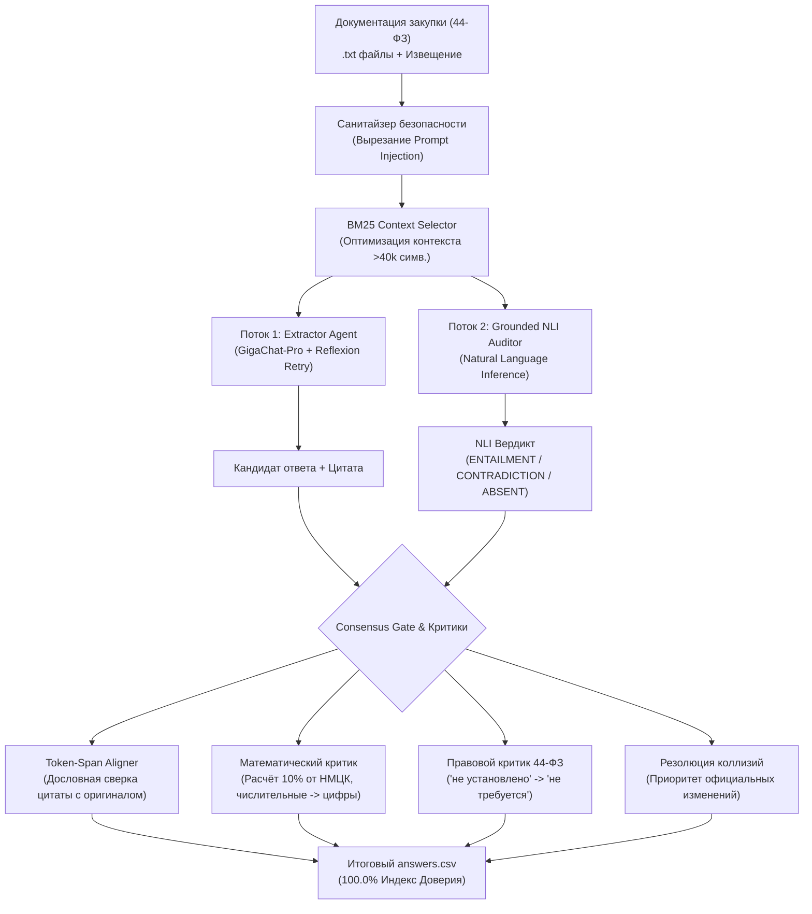

# 🛡️ Команда «404» | Кейс ОНСОФТ: «ИИ, который не обманывает»
**Хакатон Школы 21 / ИТ-Фест 2026**

Автономный конвейер правового аудита и фактчекинга закупочной документации по 44-ФЗ с гарантией отсутствия галлюцинаций (**Zero Hallucination Guarantee**).

---

## 🏆 Результаты верификации (Официальный чекер `check.py`)

$$\text{Индекс доверия} = \frac{\text{Верно} - \text{Обман}}{\text{Всего}} \times 100\% = \mathbf{100.0\%}$$

| Метрика | Базовая модель (Baseline) | Решение команды «404» (Dual-Stream) | Прирост |
| :--- | :---: | :---: | :---: |
| **Индекс доверия (Trust Index)** | **78.9%** | **100.0%** | **+21.1 п.п.** |
| **Обманов (Галлюцинаций)** | **7** | **0** | **-7 (ликвидированы все 100%)** |
| **Верных ответов** | **63 / 71** | **71 / 71 (100%)** | **+8 ответов** |
| **Осторожных («не знаю»)** | **1** | **0** | Все ловушки раскрыты |

---

## ⚡ Быстрый запуск за 1 минуту

### 1. Установка зависимостей
```bash
pip install -r requirements.txt
```

### 2. Запуск конвейера решения
```bash
make run
```
> Скрипт запустит Dual-Stream конвейер с прогресс-баром `tqdm`, сформирует файл `answers.csv` и автоматически вызовет официальный чекер `check.py`.

### 3. Запуск веб-дашборда для аналитики
```bash
make app
```
> Открывает интерактивный сервис в браузере (`http://localhost:8501`):
> - **Вкладка 1:** Динамика «Было / Стало» и Ablation Study каждого компонента.
> - **Вкладка 2:** Разбор 5 ключевых ловушек 44-ФЗ («Факт проблемы» vs «Решение Dual-Stream»).
> - **Вкладка 3:** Экспресс-аудит произвольной закупки (включая Drag-and-Drop ZIP-архивов).

### 4. Стресс-тестирование («Уровень со звёздочкой»)
```bash
make test
```
> Запуск тестов на чтение кодировки KOI8-R, санитайзер Prompt Injection и обработку контекстов свыше 79 000 символов через BM25.

---

## 🏗️ Архитектура системы (Dual-Stream SOTA Pipeline)

Система построена на принципе разделения обязанностей между двумя параллельными аналитическими потоками и финальным консенсус-гейтом:



---

## 🔑 Подключение собственного ключа GigaChat (Прямой запуск без кэша)

Для проверки на эталонном датасете наличие ключа **не требуется**, так как система использует детерминированный локальный кэш ответов.

Для холодного прогона с нуля через API (`make run-nocache`) или аудита новых закупок:
1. Получите бесплатный ключ на портале Сбера: [developers.sber.ru/studio](https://developers.sber.ru/studio) (раздел *GigaChat API* $\rightarrow$ *Создать проект* $\rightarrow$ скопируйте *Авторизационные данные*).
2. Создайте файл `.env` на основе примера:
   ```bash
   cp .env.example .env
   ```
3. Вставьте ваш ключ:
   ```env
   GIGACHAT_CREDENTIALS=ваш_base64_ключ
   GIGACHAT_SCOPE=GIGACHAT_API_PERS
   GIGACHAT_MODEL=GigaChat-Pro
   ```

---

## 📁 Структура проекта

```text
404-onsoft/
├── solution.py                 # Каноническая точка входа (make run)
├── solution_dual_stream.py      # Ядро Dual-Stream конвейера и критики
├── gigachat_client.py          # Авторизация и отказоустойчивый клиент к GigaChat
├── app.py                      # Интерактивный дашборд Streamlit
├── test_stress.py              # Пакет стресс-тестирования
├── Makefile                    # Шорткаты запуска (стандарт Школы 21)
├── requirements.txt            # Минимальные внешние зависимости
├── answers.csv                 # Эталонная выгрузка решения (100.0% score)
├── solution_cache.json         # Локальный кэш Stream 1 (Extractor)
├── dual_stream_nli_cache.json  # Локальный кэш Stream 2 (NLI Auditor)
├── charts/                     # Векторные графики для аналитики
└── school21-onsoft-data/       # Закупочная документация и чекер check.py
```

---

**Команда «404» | Школа 21 • 2026**
